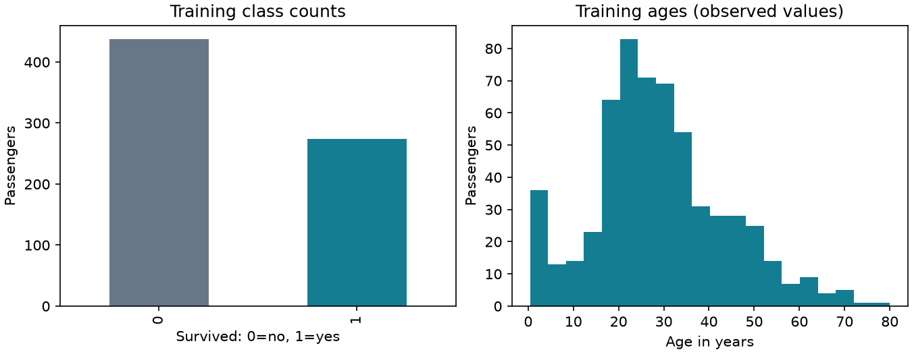

# Titanic Survival: Naive Bayes vs Logistic Regression

A comparison of two classic classifiers with the input data, fitted models, generated graphs and final findings in one compact project.

## Access and run the project

### 1. Get the files

```bash
git clone https://github.com/ArnavGoel28/Titanic-Dataset.git
cd Titanic-Dataset
```

The labeled input CSV and fitted model bundles are included. You can inspect the [final report](FINAL_REPORT.md) and results directly on GitHub.

### 2. Install dependencies

Use Python 3.12, the tested version.

**Windows PowerShell**

```powershell
py -3.12 -m venv .venv
.venv/Scripts/python.exe -m pip install -r requirements.txt
.venv/Scripts/python.exe titanic.py
```

**macOS / Linux**

```bash
python3.12 -m venv .venv
.venv/bin/python -m pip install -r requirements.txt
.venv/bin/python titanic.py
```

Running `titanic.py` fits both models on the same training records and regenerates the two model bundles, output tables, graphs and `FINAL_REPORT.md`.

## Project layout

```text
Titanic-Dataset/
|-- data/
|   |-- train.csv
|   `-- split.json
|-- models/
|   |-- naive_bayes.joblib
|   `-- logistic_regression.joblib
|-- output/
|   |-- graphs/
|   |   |-- data_overview.png
|   |   `-- confusion_matrices.png
|   |-- results.csv
|   |-- summary.json
|   `-- missing_values.csv
|-- titanic.py
|-- FINAL_REPORT.md
|-- README.md
`-- requirements.txt
```

### Saved models

Each `.joblib` file contains a fitted estimator and its preprocessing settings: numeric medians, categorical modes and categories, encoded feature order, and fitted scaler. The bundles also record library versions, data checksum and split sizes.

```python
import joblib

bundle = joblib.load("models/logistic_regression.joblib")
model = bundle["model"]
preprocessing = bundle["preprocessing"]
```

The estimator expects prepared features in the saved column order. Apply the stored preprocessing to new rows; `titanic.py` shows the preparation steps. The supplied bundles were generated with the versions pinned in `requirements.txt`.

## Input and preparation

Input: [Kaggle Titanic - Machine Learning from Disaster](https://www.kaggle.com/competitions/titanic/data), subject to [competition rules](https://www.kaggle.com/competitions/titanic/rules). Source terms apply to the data; no separate data license is asserted here. The included `data/train.csv` is the original labeled file, not Kaggle's unlabeled competition test file.

- **891 passengers**, 12 source columns and 7 model predictors.
- **342 survivors** and 549 non-survivors; positive class is `Survived = 1`.
- **712 training / 179 test** records, fixed in `data/split.json` for both models.
- SHA-256: `7d118fef8b6ccf7f81111877bc388536f7b1e498a655e3d649d19aaa010e9f6f`.

| Type | Predictors | Preparation |
| --- | --- | --- |
| Numeric | Age, SibSp, Parch, Fare | Training-median fill, then standardization |
| Categorical | Pclass, Sex, Embarked | Training-mode fill and one-hot encoding |

Age has 177 missing entries, Cabin 687, and Embarked 2. PassengerId, Name, Ticket and Cabin are excluded from model predictors. No exact duplicate passenger records were found. Zero and extreme fares are kept because they are not proven errors. All preparation statistics come from training records only.



*Training data only. The age histogram uses observed ages.*

## Results

Default GaussianNB and LogisticRegression settings are used, with LR `max_iter=1000` allowing convergence. Survival predictions use threshold 0.5. Precision, recall and F1 refer to the survival class.

| Model | Accuracy | Precision | Recall | F1 | ROC-AUC | Log-loss |
| --- | ---: | ---: | ---: | ---: | ---: | ---: |
| Naive Bayes | 78.77% | 0.7206 | 0.7206 | 0.7206 | 0.8409 | 0.6546 |
| Logistic Regression | 80.45% | 0.7538 | 0.7206 | 0.7368 | 0.8650 | 0.4342 |

The majority-class reference scores **62.01% accuracy** (111/179 correct). Higher accuracy, F1 and ROC-AUC are better; lower log-loss is better.


*Rows are true labels; columns are predictions. The bottom row contains actual survivors.*

### Findings

Logistic Regression correctly classifies **144/179** passengers, compared with **141/179** for Naive Bayes: a **1.68 percentage-point** accuracy difference. Both find **49 of 68 survivors** and miss 19. LR makes **16 false-positive survival predictions**, compared with 19 for NB.

LR also has higher ROC-AUC (**0.865 vs 0.841**) and lower log-loss (**0.434 vs 0.655**) in this run. These probability metrics add information about ranking and confidence beyond the prediction threshold.

The models agree on **168/179** passengers: both are correct for 137 and wrong for 31. Of the 11 disagreements, LR alone is correct 7 times and NB alone 4 times. See the [final findings report](FINAL_REPORT.md) and [metrics CSV](output/results.csv).

## Interpretation and limits

GaussianNB assumes conditionally independent Gaussian features. Family counts and one-hot indicators do not match that assumption exactly. Logistic Regression models linear log-odds. These assumptions help frame the comparison but do not establish the cause of the measured difference.

The saved split keeps identified ticket/family travel groups together. It was originally fixed using fold 0 of `StratifiedGroupKFold(5, shuffle=True, random_state=42)` over connected shared-ticket or surname/family-size groups. These are imperfect proxies for companions.

Results describe a small historical sample and one partition inspected during earlier development. The comparison is not an independent external evaluation or evidence that one model is universally superior. No settings are adjusted to improve these test scores. Historical associations are not causal conclusions.

## References

- [Kaggle Titanic data and dictionary](https://www.kaggle.com/competitions/titanic/data)
- [scikit-learn: Naive Bayes](https://scikit-learn.org/stable/modules/naive_bayes.html)
- [scikit-learn: Logistic Regression](https://scikit-learn.org/stable/modules/linear_model.html#logistic-regression)
