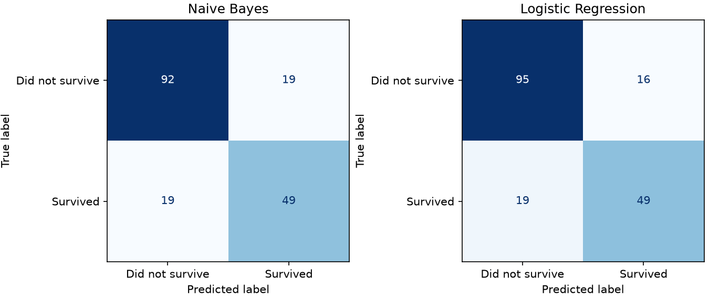

# Titanic classification assignment

## Objective and dataset
Compare Gaussian Naive Bayes and Logistic Regression on Kaggle Titanic data.
Source: https://www.kaggle.com/competitions/titanic/data (subject to competition rules).
The labeled train.csv has 891 passengers, 12 columns, 342 survivors and 549 non-survivors.
Positive class: Survived=1. Kaggle's unlabeled test.csv is not used.

## Data preparation
Missing: Age 177, Cabin 687, Embarked 2. No complete duplicate records were found.
Use Age, SibSp, Parch, Fare, Pclass, Sex and Embarked. Exclude identity/detail fields
PassengerId, Name, Ticket and Cabin. Keep zero/extreme fares because they are not proven errors.
Reuse the fixed travel-group-separated split: 712 train / 179 test.
Fill numeric gaps with training medians, categorical gaps with training modes.
Encode using training categories and scale numeric values using training statistics.
No oversampling, feature search, parameter search or threshold tuning is used.

## Models and measures
GaussianNB assumes class-conditional independent Gaussian features; counts and
categorical indicators violate that approximation. LR estimates sigmoid probabilities
with linear log-odds. Both use defaults; LR max_iter=1000 allows convergence.
Accuracy=(TP+TN)/N; precision=TP/(TP+FP); recall=TP/(TP+FN);
F1=2TP/(2TP+FP+FN). Undefined precision/recall use zero_division=0.
ROC-AUC uses probabilities; log-loss measures probability confidence.

## Results
Majority-class baseline accuracy: 0.620.

```text
                     Accuracy  Precision  Recall      F1  ROC-AUC  Log-loss
Model
Naive Bayes            0.7877     0.7206  0.7206  0.7206   0.8409    0.6546
Logistic Regression    0.8045     0.7538  0.7206  0.7368   0.8650    0.4342
```



## Final findings and analysis
Naive Bayes: accuracy 0.788, F1 0.721, log-loss 0.655.
Logistic Regression: accuracy 0.804, F1 0.737, log-loss 0.434.
The models agreed on 168 of 179 test passengers.
Highest accuracy in this run: Logistic Regression.
These results apply to this split and preprocessing. No parameter tuning was done in this notebook.

Naive Bayes correctly classified 141/179 passengers; Logistic Regression correctly classified 144/179. The majority-class reference correctly classified 111/179.

Among 68 actual survivors, NB found 49 and missed 19; LR found 49 and missed 19. NB made 19 false-positive survival predictions, compared with 16 for LR. LR-minus-NB accuracy difference: 1.68 percentage points.

Both models were correct for 137 passengers and wrong for 31. Of the 11 disagreements, LR alone was correct 7 times and NB alone 4 times.

Probability ranking (ROC-AUC): NB 0.841, LR 0.865. Probability error (log-loss, lower is better): NB 0.655, LR 0.434. Ranking quality and confidence should be considered alongside accuracy.

For this assignment's fixed split, LR performed better on accuracy, F1, ROC-AUC and
log-loss; both models found the same number of survivors. This is a result for this
sample and preparation, not evidence that LR is always better.

Related predictors can challenge NB's conditional independence assumption. LR permits
correlated predictors but uses linear log-odds. Ranking and threshold metrics may favor
different models. These observations do not establish a causal explanation for differences.
The small historical sample and one split limit generalization. Travel groups are
imperfect proxies for companions. The test partition was evaluated in earlier development;
this simplified default-model comparison is not a new independent experiment.
No setting was adjusted to improve these test scores.

## Reproduction and references
Run `python assignment.py` or execute `notebooks/assignment.ipynb` from top to bottom.
Tables, plots and this report are generated from real results.
- Data/rules: https://www.kaggle.com/competitions/titanic/data and https://www.kaggle.com/competitions/titanic/rules
- NB: https://scikit-learn.org/stable/modules/naive_bayes.html
- LR: https://scikit-learn.org/stable/modules/linear_model.html#logistic-regression
